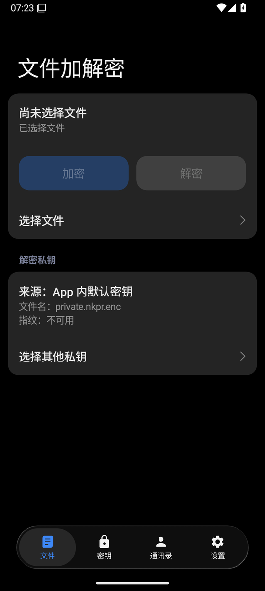
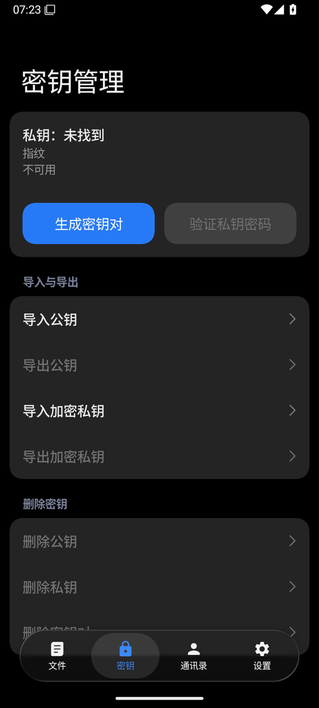
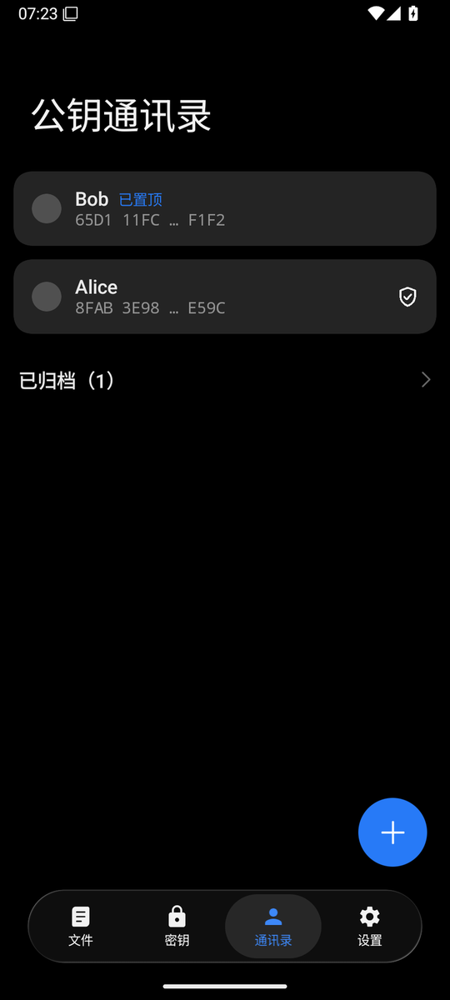
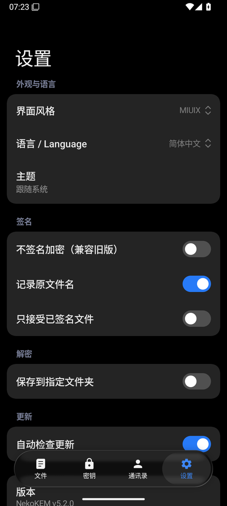
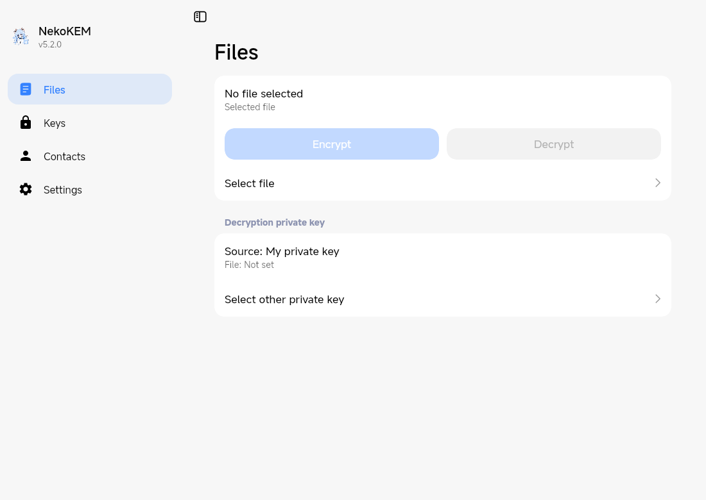
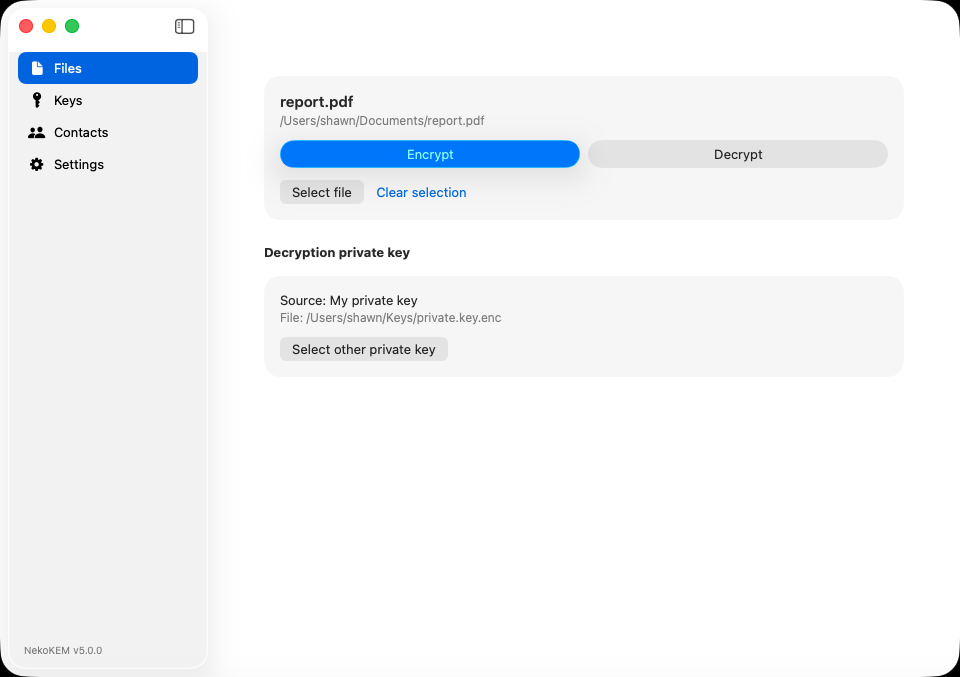

[简体中文](README.md) | [English](README.en.md)

<div align="center">


# NekoKEM

**Cross-platform file encryption with post-quantum hybrid cryptography**

X448 + ML-KEM-1024 hybrid key encapsulation · Ed448 + ML-DSA-87 dual signatures · Android / Windows / macOS / Linux

[](https://github.com/Shixiaoshi0417/NekoKEM/releases/latest)
[](https://github.com/Shixiaoshi0417/NekoKEM/actions/workflows/ci.yml)
[](https://github.com/Shixiaoshi0417/NekoKEM/releases)
[](LICENSE)
[](https://openssl-library.org/)
[](#downloads)

[Downloads](#downloads) · [Quick start](#quick-start) · [Cryptographic design](#cryptographic-design) · [Security boundaries](#security-boundaries) · [v6.1.0 release notes](release/v6.0.0.md)

</div>

> [!WARNING]
> NekoKEM is an experimental project for learning the OpenSSL EVP API. **It has not undergone a security audit, must not be considered production-grade software, and must not be used to protect important or sensitive data.**

## Highlights

<table>
<tr>
<td width="33%" valign="top">

**Post-quantum hybrid encryption**<br>
One X448 + ML-KEM-1024 encapsulation per recipient, HKDF-SHA512 key derivation, and AES-256-GCM streaming in 64 KiB chunks.

</td>
<td width="33%" valign="top">

**Sender signatures by default**<br>
NKEM v5 is signed with Ed448 + ML-DSA-87. Core verifies the signatures on decryption, shows the signer fingerprint, and can accept trusted signers only.

</td>
<td width="33%" valign="top">

**Multi-recipient encryption**<br>
Encrypt one file to up to 64 recipients. The data is encrypted once, and each recipient opens it with their own private key.

</td>
</tr>
<tr>
<td width="33%" valign="top">

**Key-committing private keys**<br>
NKPR v3 protects private keys with Argon2id, and a private key file opens under one password only. Plaintext private keys never touch the disk.

</td>
<td width="33%" valign="top">

**Public-key contacts**<br>
Save contacts' public keys with notes, compare full fingerprints or scan fingerprint QR codes. Core re-checks the fingerprint before every encryption.

</td>
<td width="33%" valign="top">

**Native apps everywhere**<br>
Android (MIUIX / Material 3 Expressive), Windows and Linux (Compose), macOS (SwiftUI) and the CLI, in five interface languages.

</td>
</tr>
</table>

## Screenshots

<p align="center">
  
  
  
  
</p>
<p align="center"><sub>Android · MIUIX style · dark mode</sub></p>

<p align="center">
  
  
</p>
<p align="center"><sub>Left: Windows / Linux (Compose Multiplatform) · Right: macOS (SwiftUI)</sub></p>

## Downloads

The current version is **v6.1.0**. Every package is on the [GitHub Release](https://github.com/Shixiaoshi0417/NekoKEM/releases/tag/v6.1.0); see [Release v6.1.0](#release-v610) below for what changed.

| Platform and architecture | CLI / Android | GUI |
|---|---|---|
| Android 8.0+ ARM64 | [APK](https://github.com/Shixiaoshi0417/NekoKEM/releases/download/v6.1.0/app-release.apk) | Interface included in APK |
| Windows 10/11 x64 | [CLI ZIP](https://github.com/Shixiaoshi0417/NekoKEM/releases/download/v6.1.0/NekoKEM-windows-x86_64.zip) | [MSI](https://github.com/Shixiaoshi0417/NekoKEM/releases/download/v6.1.0/NekoKEM-Windows-GUI.msi) · [EXE](https://github.com/Shixiaoshi0417/NekoKEM/releases/download/v6.1.0/NekoKEM-Windows-GUI.exe) · [ZIP](https://github.com/Shixiaoshi0417/NekoKEM/releases/download/v6.1.0/NekoKEM-Windows-GUI.zip) |
| macOS Apple Silicon arm64 | [CLI TAR.GZ](https://github.com/Shixiaoshi0417/NekoKEM/releases/download/v6.1.0/NekoKEM-macos-arm64.tar.gz) | [GUI ZIP](https://github.com/Shixiaoshi0417/NekoKEM/releases/download/v6.1.0/NekoKEM-macos-arm64-GUI.zip) · [DMG](https://github.com/Shixiaoshi0417/NekoKEM/releases/download/v6.1.0/NekoKEM-macos-arm64-GUI.dmg) |
| iOS / iPadOS 16+ arm64 | — | [IPA (unsigned)](https://github.com/Shixiaoshi0417/NekoKEM/releases/download/v6.1.0/NekoKEM-iOS-arm64-unsigned.ipa) |
| Linux x86_64 | [Static CLI](https://github.com/Shixiaoshi0417/NekoKEM/releases/download/v6.1.0/NekoKEM-linux-x86_64.tar.gz) | [DEB](https://github.com/Shixiaoshi0417/NekoKEM/releases/download/v6.1.0/NekoKEM-linux-x86_64-GUI.deb) · [RPM](https://github.com/Shixiaoshi0417/NekoKEM/releases/download/v6.1.0/NekoKEM-linux-x86_64-GUI.rpm) · [Portable](https://github.com/Shixiaoshi0417/NekoKEM/releases/download/v6.1.0/NekoKEM-linux-x86_64-GUI.tar.gz) · [AppImage](https://github.com/Shixiaoshi0417/NekoKEM/releases/download/v6.1.0/NekoKEM-linux-x86_64-GUI.AppImage) · [Flatpak](https://github.com/Shixiaoshi0417/NekoKEM/releases/download/v6.1.0/NekoKEM-linux-x86_64-GUI.flatpak) |
| Linux ARM64 / aarch64 | [Static CLI](https://github.com/Shixiaoshi0417/NekoKEM/releases/download/v6.1.0/NekoKEM-linux-aarch64.tar.gz) | [DEB](https://github.com/Shixiaoshi0417/NekoKEM/releases/download/v6.1.0/NekoKEM-linux-aarch64-GUI.deb) · [RPM](https://github.com/Shixiaoshi0417/NekoKEM/releases/download/v6.1.0/NekoKEM-linux-aarch64-GUI.rpm) · [Portable](https://github.com/Shixiaoshi0417/NekoKEM/releases/download/v6.1.0/NekoKEM-linux-aarch64-GUI.tar.gz) · [AppImage](https://github.com/Shixiaoshi0417/NekoKEM/releases/download/v6.1.0/NekoKEM-linux-aarch64-GUI.AppImage) · [Flatpak](https://github.com/Shixiaoshi0417/NekoKEM/releases/download/v6.1.0/NekoKEM-linux-aarch64-GUI.flatpak) |

Verify each downloaded archive against [SHA256SUMS.txt](https://github.com/Shixiaoshi0417/NekoKEM/releases/download/v6.1.0/SHA256SUMS.txt), then verify its internal checksums. The Linux GUI requires glibc 2.39+, and its DEB/RPM depend on Noto Sans CJK fonts and `curl`. The macOS GUI needs macOS 13 or newer; the CLI has an 11.0 deployment target. Platform installation steps and signing limits are described in the platform sections below.

Releases after v4.1.0 also carry GitHub build provenance for every asset. With the GitHub CLI, confirm that a file was built by this repository's Release workflow on `main` (substitute the asset you downloaded):

```sh
gh attestation verify NekoKEM-linux-x86_64.tar.gz --repo Shixiaoshi0417/NekoKEM \
  --signer-workflow Shixiaoshi0417/NekoKEM/.github/workflows/release.yml \
  --source-ref refs/heads/main --deny-self-hosted-runners
```

## Quick start

| Platform | Installation |
|---|---|
| Android | Install the APK; v3.2.0 and later update in place |
| Windows | Run the EXE installer or the MSI; the CLI ZIP runs after unpacking. See [Windows CLI and GUI](#windows-cli-and-gui) |
| macOS | Open the DMG or unpack the GUI ZIP; packages are ad-hoc signed only. See [macOS Apple Silicon CLI and GUI](#macos-apple-silicon-cli-and-gui) |
| Debian / Ubuntu | `sudo apt install ./NekoKEM-linux-x86_64-GUI.deb` |
| Fedora | `sudo dnf install ./NekoKEM-linux-x86_64-GUI.rpm` |
| Arch Linux | `makepkg -si` in `linux/arch`. See [Arch Linux](#arch-linux) |
| Flatpak | `flatpak install --user ./NekoKEM-linux-x86_64-GUI.flatpak`. See [Flatpak](#flatpak) |
| AppImage | Run it after `chmod +x`. See [AppImage](#appimage) |
| Linux CLI | The install script verifies the download. See [Linux CLI installation](#linux-cli-installation) |

On ARM64, replace `x86_64` in the file name with `aarch64`. With the CLI, three steps generate keys, encrypt and decrypt. The example encrypts a file to yourself (`keys/public.key`) and to Bob's public key, signs it with your own private key by default, then opens it with your own private key:

```sh
nekokem keygen
nekokem encrypt hybrid report.pdf report.pdf.nkem keys/public.key bob.key
nekokem decrypt hybrid report.pdf.nkem decrypted.pdf keys/private.key.enc
```

For the interactive menu, every option and the directory conventions, see [Default interactive mode](#default-interactive-mode) and [Parameterized commands](#parameterized-commands).

## Cryptographic design

By default NekoKEM writes NKEM v5 file containers signed by the sender (1 to 64 recipients); unsigned encryption writes NKEM v3 (one recipient) or NKEM v4 (several recipients) Hybrid file containers. Decryption on every platform recognizes v3, v4 and v5 automatically.

| Mode | Key establishment | KDF | File encryption | Container |
|---|---|---|---|---|
| v5 signed (default) | X448 + ML-KEM-1024 per recipient | HKDF-SHA512 | As v4, plus an encrypted Ed448 + ML-DSA-87 sender signature | version 5 / algorithm id 5 |
| v3 hybrid (unsigned, one recipient) | X448 + ML-KEM-1024 | HKDF-SHA512 | AES-256-GCM | version 3 / algorithm id 3 |
| v4 multi-recipient (unsigned) | X448 + ML-KEM-1024 per recipient | HKDF-SHA512 | AES-256-GCM key wrap and data, HMAC-SHA512 header MAC | version 4 / algorithm id 4 |

The project does not implement cryptographic algorithms itself and does not depend on liboqs; every algorithm comes from OpenSSL EVP. The format specifications are [NKEM v5](docs/NKEM-v5.md), [NKEM v4](docs/NKEM-v4.md), [NKEM v3](docs/NKEM-v3.md) and [key commitment](docs/key-commitment.md).

## Documentation map

| Topic | Sections |
|---|---|
| Usage | [Multi-recipient encryption](#multi-recipient-encryption) · [Language settings](#language-settings) · [Default interactive mode](#default-interactive-mode) · [Parameterized commands](#parameterized-commands) · [Update checks](#update-checks) · [Fingerprint QR codes](#fingerprint-qr-codes) |
| Platforms | [Android contacts](#android-public-key-contacts) · [Desktop contacts](#desktop-gui-public-key-contacts) · [Windows](#windows-cli-and-gui) · [macOS](#macos-apple-silicon-cli-and-gui) · [iOS](#ios-unsigned-ipa) · [Linux GUI](#linux-gui) · [Linux CLI](#linux-cli-installation) |
| Formats | [NKPR private keys](#nkpr-encrypted-private-key-format) · [NKEM v3](#nkem-v3-hybrid-file-format) · [NKEM v4](#nkem-v4-multi-recipient-file-format) · [NKEM v5](#nkem-v5-signed-file-format) |
| Security | [Security implementation](#security-implementation) · [Security boundaries](#security-boundaries) · [Vulnerability reports](#security-notice-and-vulnerability-reports) |
| Development | [Dependencies](#dependencies) · [Building](#building) · [Automated tests](#automated-tests) · [AFL++ fuzzing](#afl-fuzzing) · [Performance measurements](#performance-measurements) |

## Release v6.1.0

Android and every CLI/GUI application are `6.1.0`; Core stays `6.0`, with unchanged NKEM and NKPR file formats and cryptographic parameters:

- New unsigned iOS / iPadOS IPA (iOS 16 or newer), sharing the SwiftUI interface with the macOS GUI and laid out like the Android app; install it with a sideloading tool.
- Tablet and iPad layouts: wide screens get side navigation, centred content of limited width and two-pane contacts.
- The Android MIUIX style gains liquid glass: a frosted title bar, a glass side rail and add button, and dialogs that blur the page behind them on Android 12 and newer.
- The Android Material 3 style offers a choice of theme color (blue by default), and Dynamic color from Android 12, off by default.
- The Files page in every app shows only the file name or "No file selected", with Encrypt and Decrypt both grey until a file is chosen.

**NekoKEM 5.2.0 and earlier cannot open the NKPR v3 private keys used since 6.0.0**: to move a key to an older version, first use "Export private key for 5.2 and earlier" (`export-legacy-private-key` in the CLI). The first unlock after upgrading from 5.2.0 rewrites your own key as NKPR v3, so export it this way before rolling back too. NKEM files are unaffected: 6.x and 5.2.0 decrypt each other's files. **NekoKEM 4.x and earlier cannot read NKEM v5, NKPR v2/v3 or four-component public keys**; for recipients on an old version, turn on unsigned encryption and use the legacy public key. See the bilingual [v6.1.0](release/v6.1.0.md) and [v6.0.0](release/v6.0.0.md) notes and the [GitHub Release](https://github.com/Shixiaoshi0417/NekoKEM/releases/tag/v6.1.0).

Android v6.1.0 retains the v3.2.0/v3.3.0 signing identity and supports an in-place update; back up the public key, encrypted NKPR private key and its password, especially before upgrading the key. Only v3.1.x installations with the old signer need backup verification followed by uninstall/reinstall; uninstalling deletes app-private keys. NKEM v1/v2 are no longer supported.

README uses a dedicated rounded display image. Android retains the existing square artwork with its white background; Windows CLI/GUI EXE icons retain the square artwork with the outer white area made transparent. Windows applications are not Authenticode signed.

## Multi-recipient encryption

One file can be encrypted for up to 64 recipients at once. Each recipient decrypts it with their own
private key; nobody else can. In the desktop GUI, tick several contacts on the Public-key contacts page
and choose Encrypt for selected, or tick recipients in the encryption page's recipient list. On Android,
tick Select as recipient on the Public-key contacts page and choose Encrypt for Selected Recipients. The default is
signed NKEM v5, one format for 1 to 64 recipients; with unsigned encryption turned on, one selected contact
writes NKEM v3 and two or more write one NKEM v4 file. Every contact is re-read and its
fingerprint re-validated by Core before encryption. A missing, damaged or mismatched contact fails the
whole operation and is named; no recipient is skipped or replaced by another public key. On the CLI, list
several public keys after the usual command; see [Parameterized commands](#parameterized-commands).

NKEM v4 and v5 store one X448 + ML-KEM-1024 encapsulation and wrapped file key per recipient and encrypt the
file data once. An HMAC-SHA512 header MAC ensures every recipient decrypts the same content. See
[`docs/NKEM-v4.md`](docs/NKEM-v4.md) and [`docs/NKEM-v5.md`](docs/NKEM-v5.md) for the formats. Decryption on
every platform detects v3, v4 and v5 automatically. Multi-recipient encryption is available from v4.0.0 and
signed v5 from v5.0.0; NekoKEM v3.3.2 and earlier cannot open v4 files, and 4.x and earlier cannot open v5 files.

## Android public-key contacts

Import a recipient's public key and add a note in the drawer's Public-key contacts page,
then choose a saved entry when encrypting. Notes can be edited, entries deleted, and
duplicate fingerprints are stored once. Contacts persist in app-private storage. Each
use validates the key and fingerprint with the existing Core; an unavailable entry
requires an explicit new selection. Notes are labels; verify fingerprints with recipients.
Contacts are separate from local default keys, which always form one key pair: an imported private
key must match the stored public key, and replacing your own public key asks for confirmation and,
while a private key is stored, its password. Cryptographic parameters and file formats
remain unchanged. See the [Android documentation](android/README.md#公钥通讯录)
for behavior and device tests. This release also supports Android predictive back:
secondary pages and the navigation drawer follow the back gesture; see
[predictive back](android/README.md#预测性返回). These features are available from v3.3.2; v3.3.1 and earlier do not
include them.

Android serializes local-key mutations within the process and shares Core's directory lock. Startup only cleans app-owned temporary candidates and empty output backups older than 24 hours; possible recovery copies are retained with a warning. Password dialogs block screenshots and recording, and owned password arrays are cleared promptly; immutable copies produced by Compose and keyboards cannot be reliably erased. All cloud backup and device-transfer domains are explicitly excluded. Failed SAF saves attempt to restore prior content, but providers may retain empty destinations that need manual removal. Release builds enable R8, and CI repeats the JNI and callback device tests on the minified build. See the [Android security boundaries](android/README.md).

## Desktop GUI public-key contacts

The desktop GUI on Windows, macOS and Linux has a
Public-key contacts page. Save a recipient's public key from a file or pasted text, add or
edit a note, and delete entries after confirmation. The encryption page can choose a saved
contact, and a contact's Use for encryption action opens that page with it selected. Lists
and the selection show the full SHA-256 fingerprint; each fingerprint is stored once. Entries
live in a private `contacts` directory beside the language preference and contain only the
Core-normalized public key, fingerprint, source file name and note. Every encryption re-reads
the entry and re-validates its fingerprint with the existing Core. Missing, damaged,
unsafe-permission or mismatched entries fail and require a new selection; another public key
is never substituted. Notes are labels; verify full fingerprints with recipients. All five
interface languages are updated. Cryptographic parameters, file formats and secret clearing
remain unchanged. See the [desktop GUI documentation](desktop/README.md#public-key-contacts--公钥通讯录).
This feature is available from v3.3.2; v3.3.1 and earlier do not include it.

Desktop encryption and decryption report an existing output before writing; confirm replacement and retry, re-entering the decryption password. Unconfirmed operations publish atomically without replacement, so a target created during the operation is also preserved; on volumes with neither hard links nor a no-replace rename (FAT or exFAT on macOS, some network mounts), the commit instead checks the target immediately before an ordinary rename. The backend accepts replacement only at the exact paths from its preceding `key-exists` or `output-exists` response in the same session, once within five minutes and consumed by the next operation. POSIX pasted keys prefer a safe `$XDG_RUNTIME_DIR`, then on macOS the per-user temporary directory (outside Time Machine), then private `~/.nekokem-tmp`; staging disables stdio buffering and omits `fsync`. Recipient lists show full fingerprints; names drop controls, separators and every Unicode format character, keeping a zero-width joiner or non-joiner only between two visible non-ASCII characters.

## Linux CLI installation

The Linux x86_64/aarch64 CLI packages have no runtime shared-library dependencies. The installer selects the package for the local architecture from the latest published Release, resolved once so every download comes from the same release; `NEKOKEM_RELEASE_TAG=v6.1.0 sh install.sh` installs a specific release, and the installed binary must report that version. It first verifies the archive against the release's top-level `SHA256SUMS.txt`, then verifies SHA-256 hashes of the files inside the package:

```sh
curl --fail --location --output install.sh \
    https://raw.githubusercontent.com/Shixiaoshi0417/NekoKEM/main/linux/install.sh
less install.sh
sh install.sh
```

Checksums verify download integrity, not provenance. `NEKOKEM_VERIFY_ATTESTATION=1 sh install.sh` additionally invokes `gh attestation verify`; this applies to attested releases after `v4.1.0` and refuses installation of `v4.1.0` and earlier, which carry no provenance attestation.

## Dependencies

Debian 13:

```sh
sudo apt install libssl-dev build-essential
```

OpenSSL 3.5 or newer is required because EVP support for ML-KEM begins with OpenSSL 3.5. Source builds and CI on all platforms pin OpenSSL 4.1.0 and verify the official source SHA-256.

To build the AFL++ fuzz harnesses, also install:

```sh
sudo apt install afl++
```

## Building

```sh
make -C linux
```

The build uses C17 and links OpenSSL `libcrypto`. Hybrid private-key protection uses Argon2id from the OpenSSL provider; no separate `libargon2` installation is needed. The default build enables `-Werror`, `-fstack-protector-strong`, `-D_FORTIFY_SOURCE=3`, `-fPIE`, and `-pie`.

The executable is `linux/nekokem`. The `./nekokem` examples below assume the working directory is `linux/`, or another directory containing a copy of that executable.

GitHub Actions uses [CI](.github/workflows/ci.yml) and [Release](.github/workflows/release.yml). CI builds and runs all platform security, language, interoperability, performance and GUI regression checks on PRs and main pushes. Release builds Linux CLI archives and GUI installation/portable packages, a signed Android APK, Windows CLI/GUI packages and macOS arm64 packages through manual runs or `v*` tags. See the [build workflow documentation](release/README.md) for signing identity and artifact details.

Publish uploads and publishes using the known release ID and checks existing versions across all API pages. Only the highest stable semantic version becomes Latest. Matching partial drafts can resume; upload or verification failures restore draft status, and failed recovery explicitly reports the release ID and unconfirmed state. Publish verifies the version, source commit and build run inside Windows CLI/GUI packages. CI checks that application, packaging and Android signing-verification versions agree without changing version numbers.

Rust, Node and Python are pinned to `1.99.0`, `24.21.0` and `3.13.16`. MSYS2 uses a rolling repository and retains full updates to avoid ABI and dependency mismatches from historical package combinations or partial upgrades; build records include the actual compiler version. Release builds remain uncached, APK building and signing stay separate, and signing runs only on `main`. See the [release process](release/README.md).

## Windows CLI and GUI

v6.1.0 provides the native Windows 10/11 x64 CLI `nekokem.exe` as a portable package, and the GUI as an MSI installer, an EXE installer and a ZIP folder. The CLI shares Linux's complete argument parser and five-option menu; double-clicking the EXE or running it without arguments opens the menu. See the [Windows CLI documentation](windows/README.md) for building, use and imported-key permissions, and the [filesystem design](windows/SECURITY-DESIGN.md) for its boundaries. Running the CLI requires no MSYS2 runtime or OpenSSL DLL; building uses MSYS2 UCRT64 and pinned OpenSSL 4.1.0.

The GUI is a Compose Multiplatform app that looks like the Android app, in the MIUIX style (the default) or Material 3 Expressive. It calls the same C17 Core through the bridge library, with system file dialogs, progress and cancellation. It carries its own Java runtime and needs no WebView2 Runtime; see the [desktop GUI documentation](desktop/README.md). Since 6.0.0 releases also provide an EXE installer, `NekoKEM-Windows-GUI.exe`, that installs the same app as the MSI with a double click; CI installs it silently and starts the installed app. The CLI, the GUI and the MSI and EXE installers are not Authenticode signed.

Windows accepts local fixed NTFS only, checks ownership and ACLs, and rejects network/device/ADS/reparse paths. Protocols, cryptographic parameters and 64 KiB streaming chunks are unchanged; Windows power-loss durability is not presented as verified POSIX directory fsync. Windows stores language preferences in OS LocalAppData/NekoKEM and reads the Windows display language when no locale environment override exists. The POSIX configuration paths below apply to the Linux and macOS CLI.

## macOS Apple Silicon CLI and GUI

v6.1.0 provides a native `arm64` CLI and a native SwiftUI GUI for M-series Apple Silicon Macs. Download `NekoKEM-macos-arm64.tar.gz`, `NekoKEM-macos-arm64-GUI.zip` (containing the `.app`) or `NekoKEM-macos-arm64-GUI.dmg` from this Release. See the [macOS build and usage guide](macos/README.md) and the [desktop GUI documentation](desktop/README.md). No Intel/Rosetta build is provided.

The CLI shares Linux's argument parser, five-option menu and language catalogs. The GUI uses Apple's Liquid Glass design on macOS 26, runs on macOS 13 or newer, and has a fallback appearance on earlier systems. Both statically link pinned OpenSSL 4.1.0 and keep its arm64 assembly acceleration; they still depend on macOS system libraries and frameworks. The CLI is built with a macOS 11.0 deployment target and its native CI runs on `macos-15`; the GUI is built with the macOS 26 SDK and its CI runs on `macos-26`. This does not establish testing on real machines with earlier systems, or the compatibility and performance of every M-series generation.

The macOS file layer preserves strict ownership, permissions, symbolic-link and hard-link checks, permits only empty or deny-only extended ACLs on protected files/directories, and checks APFS/HFS+ case and Unicode name aliases. Regular output files require `fsync` and `F_FULLFSYNC`; commits require parent-directory `fsync`, without silent fallback on failure. See the [macOS filesystem design](macos/SECURITY-DESIGN.md) for limits and test boundaries. Core 6.0 reads and writes NKEM v3, v4 and v5, reads NKPR v1, v2 and v3 and writes NKPR v3, with the same cryptographic parameters and 64 KiB streaming chunks as the other platforms. Packages use ad-hoc signing only, without Developer ID or Apple notarization; this neither authenticates the publisher nor guarantees Gatekeeper acceptance.

## iOS unsigned IPA

The iOS app shares the SwiftUI interface, the Rust bridge and the C17 Core with the macOS GUI, and shows Files, Keys, Contacts and Settings as four tabs on iPhone and iPad (`arm64`, iOS 16 or newer). The release package `NekoKEM-iOS-arm64-unsigned.ipa` is unsigned: install it with a sideloading tool such as AltStore, SideStore or TrollStore. TrollStore installs it permanently; an app re-signed with a free Apple ID usually needs renewing every 7 days. The iOS app does not check for updates in the background; Settings opens the release page. See the [iOS guide](ios/README.md) for building, file locations and installation.

## Linux GUI

The Linux GUI supports `x86_64` and `aarch64` (ARM64) and is the same Compose Multiplatform app as on Windows: the MIUIX and Material 3 Expressive styles, five-language automatic detection, system file dialogs, progress and cancellation. Each architecture has `NekoKEM-linux-<arch>-GUI.deb`, `NekoKEM-linux-<arch>-GUI.rpm` and `NekoKEM-linux-<arch>-GUI.tar.gz`. On Ubuntu use `sudo apt install ./NekoKEM-linux-x86_64-GUI.deb`; on Fedora use `sudo dnf install ./NekoKEM-linux-x86_64-GUI.rpm`; for ARM64 replace the architecture in the file name with `aarch64`. After installation the app opens from the system application menu. The icon uses the existing square PNG with transparent outer white areas; the README keeps the rounded display image.

Builds and native CI use Ubuntu 24.04, and CI also installs and starts the RPM in Fedora 44 containers of the same architecture. The app carries its own Java runtime; it requires glibc 2.39 or newer, and the DEB/RPM depend on Noto Sans CJK fonts and `curl` (for the update check). OpenSSL 4.1.0 is linked statically into the bridge library with hidden symbols, full RELRO, immediate binding and a non-executable stack. Linux file permissions, authenticated commit and cancellation cleanup follow the CLI/Core; NKEM, NKPR, KDF parameters and 64 KiB streaming are unchanged. See the [desktop GUI documentation](desktop/README.md).

The v6.1.0 Release includes every Linux GUI installation package, portable package, AppImage and Flatpak bundle for both architectures, alongside the existing static CLI packages. Native window tests use X11 and do not establish testing on every Linux distribution or a physical Wayland session.

### AppImage

Since 6.0.0 releases also provide `NekoKEM-linux-<arch>-GUI.AppImage` for each architecture: a single file that runs without installation or root access after `chmod +x`. It mounts itself through FUSE, so the system needs `fusermount3` (the `fuse3` package on Debian/Ubuntu); without FUSE, run it with `--appimage-extract-and-run`. Like the portable archive, the AppImage brings no Chinese, Japanese and Korean fonts or `curl`; install them on the system. The AppImage runtime at the start of the file is a pinned release of the AppImage project's [type2-runtime](https://github.com/AppImage/type2-runtime), checked against its release signature and SHA-256 at build time; CI starts the AppImage through FUSE and checks that its window opens. Releases up to v5.2.0 have no AppImage.

### Arch Linux

On Arch Linux, use [`linux/arch/PKGBUILD`](linux/arch/PKGBUILD) (package `nekokem-bin`). It repackages the published static CLI and GUI portable archives as a pacman package and compiles nothing. The GUI installs to `/opt/nekokem`, with the `nekokem` and `nekokem-gui` commands and an application menu entry, and depends on `noto-fonts-cjk` and `curl` from the official Arch repositories. It works on x86_64 and on aarch64 with Arch Linux ARM:

```sh
git clone --depth 1 https://github.com/Shixiaoshi0417/NekoKEM.git
cd NekoKEM/linux/arch && makepkg -si
```

The PKGBUILD points at one published release and checks its SHA-256 digests. After each release, `scripts/update_arch_package.py <version>` updates its version, checksums and `.SRCINFO` (the directory can also serve as the AUR package). CI runs `makepkg` on this build's archives in an archlinux container, installs the result with `pacman -U`, and starts the GUI in English and Chinese to check that its window opens.

### Flatpak

The Flatpak, application ID `io.github.shixiaoshi0417.NekoKEM`, holds the GUI and the `nekokem` command line and runs on Flathub's Freedesktop 26.08 runtime, on x86_64 and aarch64. Since 6.0.0 releases provide a single-file bundle, `NekoKEM-linux-<arch>-GUI.flatpak`, for each architecture; installing it fetches the runtime from Flathub:

```sh
flatpak remote-add --user --if-not-exists flathub https://dl.flathub.org/repo/flathub.flatpakrepo
flatpak install --user ./NekoKEM-linux-x86_64-GUI.flatpak
flatpak run io.github.shixiaoshi0417.NekoKEM
flatpak run --command=nekokem io.github.shixiaoshi0417.NekoKEM --help
```

The [`linux/flatpak`](linux/flatpak/README.md) manifest builds from published archives; the file chooser needs 6.0.0 or later, so the manifest can be built and published directly once it points at 6.0.0. The sandbox has no file system permission: the files to work on, key files and the decryption folder are chosen in the desktop's file chooser (xdg-desktop-portal), and the app can open only what was chosen. New and upgraded key pairs are written in a private folder inside the sandbox first and then copied to the chosen paths. The `nekokem` command line inside the sandbox sees only its own data folder; for other files grant a folder for that run (for example `--filesystem=xdg-documents`) or use the static CLI archive. The sandbox has no network access; the Flatpak build does not check for updates and leaves updating to Flatpak. It draws through X11 (XWayland on Wayland). Settings, contacts and the language live in `~/.var/app/io.github.shixiaoshi0417.NekoKEM/config/nekokem`, apart from the DEB/RPM app's `~/.config/nekokem`. Chinese, Japanese and Korean text uses the fonts installed on the system. The manifest also points at one published release, and `scripts/update_flatpak_manifest.py <version>` updates it after each release. CI builds and installs the bundle from this build's archives on both architectures and starts the GUI in English and Chinese to check that its window opens. Publishing on Flathub is a step the maintainer takes; see [linux/flatpak/README.md](linux/flatpak/README.md).

## Language settings

Android, Windows/macOS/Linux GUI and the CLI support Simplified Chinese (`zh-CN`), Traditional Chinese (`zh-TW`), English (`en`), Japanese (`ja`), and Korean (`ko`). The default follows the system; unsupported languages fall back to English. Chinese CN/SG regions use Simplified Chinese; TW/HK/MO use Traditional Chinese. Other regions of en/ja/ko match their language. Android responds to system-language changes when following the system. The CLI and desktop GUI detect language on startup; the GUI can also refresh detection by choosing Follow system in its language selector.

On Android, open **Settings → Language** and select **Follow system** or a language. The choice persists and the interface refreshes. Android 13+ system application-language settings share the same preference; older systems use a private preference. Language changes are available after active file operations finish. Scrollable pages and dialogs accommodate longer text and larger fonts.

CLI examples:

```sh
./nekokem --lang ja --help
./nekokem --lang zh-TW encrypt hybrid test.txt test.nkem keys/public.key
./nekokem --set-lang ko
./nekokem --set-lang system
./nekokem --lang system --help
```

`--lang` applies to one command. On Linux and macOS, `--set-lang` saves the default in `$XDG_CONFIG_HOME/nekokem/language`, or `$HOME/.config/nekokem/language` when XDG_CONFIG_HOME is missing or relative. The configuration file has mode `0600`; no root permission is required. Priority is `--lang` → saved preference → `LC_ALL` → `LC_MESSAGES` → `LANG` → platform default (English on Linux; preferred language from CoreFoundation on macOS). `system` restores automatic detection; invalid or damaged preferences safely fall back to system detection. Common POSIX locales such as `zh_CN.UTF-8` and `ja_JP.UTF-8` are accepted for system detection. Explicit ASCII or non-UTF-8 terminal settings make CLI messages fall back to English; native macOS applications without locale environment variables use UTF-8. Global language options precede the command; subsequent file arguments are preserved verbatim. Use `--` to explicitly end global option parsing. Language configuration and help never request interactive language input.

Protocol identifiers, cryptographic algorithm names, CLI options, environment variable names, and `--version` output are unchanged. Upstream OpenSSL/OS diagnostic details retain their original text. These language options are available starting with v3.2.0; older binaries may not support them.

## Directory structure

Interactive mode consistently uses these directories:

```text
plaintext/
  plaintext files

encrypted/
  NKEM ciphertext files

keys/
  key files
```

`plaintext/`, `encrypted/`, and `keys/` are created with mode `0700` when an operation needs them. For existing paths, the program rejects symbolic links, non-directories, paths not owned by the current user, and permissions other than `0700`. The compatible parameterized commands still allow a complete output path to be specified as `output_file`.

## Default interactive mode

Run directly:

```sh
./nekokem
```

With English selected, the menu displays:

```text
====================
      NekoKEM
====================

1. Generate keys
2. Encrypt file
3. Decrypt file
4. View public-key fingerprint
5. Exit
```

Interactive encryption writes signed NKEM v5: it signs with `keys/private.key.enc` and prompts for that key's password. Unsigned NKEM v3/v4 is written only by the parameterized command's `--unsigned`. Key establishment and file encryption remain X448 + ML-KEM-1024, HKDF-SHA512, and AES-256-GCM.

### Generating keys

Selecting “Generate keys” ensures a `keys/` directory with mode `0700` exists in the working directory and generates:

- `keys/public.key`: a four-component identity public key: the X448 and ML-KEM-1024 (encryption) and Ed448 and ML-DSA-87 (signing) plaintext public keys, in that order;
- `keys/private.key.enc`: an encrypted NKPR v3 container (with key commitment) holding the four matching private-key PEM blocks, with mode `0600`.

Before generation, the program requests and confirms a private-key protection password; terminal echo is disabled during both inputs. It does not create plaintext `private.key`.

Key generation never overwrites keys: if `keys/public.key` or `keys/private.key.enc` already exists, the program refuses before asking for a password and leaves both files unchanged. To change keys, first back up the old private key (files encrypted for the old public key can only be decrypted with it), then use `keygen --replace` below.

### Encrypting files

Enter a public-key file path or paste the PEM public-key blocks (two for a legacy key, four for an identity key), then enter the source file path and the password of `keys/private.key.enc`, which signs the file; without that private key encryption fails and says to generate keys or use the parameterized command. The program ensures an `encrypted/` directory with mode `0700` exists in the working directory, creating it if necessary.

Only the source filename is used for the output in `encrypted/`, with `.nkem` appended:

```text
plaintext/test.jpg -> encrypted/test.jpg.nkem
```

### Decrypting files

Enter a private-key file path or paste the compatible plaintext PEM private-key blocks (two for a legacy key, four for an identity key). When the key file contains an NKPR container (recognized by its header, whatever the extension, for example `private.nkpr` exported by Android), the program automatically disables terminal echo and prompts for a password, then authenticates, decrypts, and parses NKPR in memory. The decrypted PEM is not written to disk. Legacy plaintext PEM private keys such as `private.key` need no password.

Terminal echo is also temporarily disabled when pasting legacy private-key contents. The internal temporary key file has mode `0600` and is deleted after the operation. Ctrl+Z at a hidden prompt shows input again while the program is stopped, and `fg` hides it again. Encrypted PKCS#8 PEM paste is rejected immediately with guidance to select an NKPR file. Secret input is refused in detected mintty/MSYS ptys that cannot reliably hide echo; use Windows Terminal or redirected standard input.

Interactive decryption refuses an existing `plaintext/<name>`, including targets created while entering the password; final publication uses an atomic no-replace operation, or, on volumes with neither hard links nor a no-replace rename, a check immediately before an ordinary rename. Menu option 5 and EOF return the most recent operation's result, with success before any operation. Only newly set private-key passwords require valid UTF-8; existing-key passwords retain their original byte interpretation. Displayed names and paths replace terminal controls, bidi controls and zero-width characters with `?`, while filesystem operations use the original paths.

The input file must end in `.nkem`. The program ensures a `plaintext/` directory with mode `0700` exists in the working directory, creating it if necessary. It uses only the container filename, removes `.nkem`, and restores the file into `plaintext/`:

```text
encrypted/test.jpg.nkem -> plaintext/test.jpg
```

Decryption still uses atomic output. The destination is committed only after Hybrid key decapsulation and AES-GCM authentication both succeed and, for a v5 file, both signatures verify; failure does not leave unauthenticated plaintext in the destination. A successful decryption shows the signature status and the signer's fingerprint, and the original file name when the file records one.

### Public-key fingerprints

“View public-key fingerprint” accepts a public-key file or pasted contents and displays an uppercase, colon-separated SHA-256 fingerprint. A four-component identity public key shows its identity fingerprint: SHA-256 over a domain-separation string and the fixed binary identity encoding of the four raw public keys (see [`docs/NKEM-v5.md`](docs/NKEM-v5.md#identity-fingerprint)). A legacy two-component public key shows the legacy fingerprint, whose input is a domain-separation string and the two public-key DER SubjectPublicKeyInfo encodings, ordered X448 then ML-KEM-1024, each preceded by a 4-byte big-endian length. Neither fingerprint depends on PEM line endings.

## Parameterized commands

Parameterized commands support scripts and development tests. Default keygen matches interactive mode and generates password-protected Hybrid keys:

```sh
./nekokem keygen
```

`keygen hybrid` remains an explicit compatible alias with the same meaning:

```sh
./nekokem keygen hybrid
```

Both forms prompt for the password twice without placing it in command-line arguments. They output `keys/public.key` and `keys/private.key.enc`, and refuse without overwriting anything if either key file already exists.

To rotate keys deliberately, back up the old private key first and pass `--replace`. The command warns that files encrypted for the old public key can only be decrypted with the old private key, and offers Ctrl+C before asking for a password:

```sh
./nekokem keygen --replace
```

Encryption writes signed NKEM v5 by default, signing with `keys/private.key.enc` (or the private key given with `--sign-key`) and prompting for its password. Decryption verifies the signature in Core and shows the signature status and signer fingerprint:

```sh
./nekokem encrypt hybrid test.txt encrypted/test.nkem keys/public.key
./nekokem decrypt hybrid encrypted/test.nkem output.txt keys/private.key.enc
```

`--trust <public key>` (repeatable) names trusted signers; `--require-signature` refuses unsigned files and `--require-trusted` accepts only trusted signers. Core enforces both and writes no plaintext when they are not met. `--save-signer <path>` saves the signer's public key, which can be used as a contact once its fingerprint is verified:

```sh
./nekokem decrypt hybrid --trust alice.key --require-trusted encrypted/from-alice.nkem output.txt keys/private.key.enc
```

For recipients still on NekoKEM 4.x or earlier, `--unsigned` writes unsigned NKEM v3/v4 (recipients cannot confirm the file came from you); give them the legacy public key from `export-legacy-public-key`. `upgrade-key` upgrades a legacy key pair in place to an identity key, keeping its encryption keys and password:

```sh
./nekokem encrypt hybrid --unsigned test.txt encrypted/test-v3.nkem keys/public.key
./nekokem export-legacy-public-key keys/public.key legacy-public.key
./nekokem upgrade-key
```

Listing two or more public keys after the usual encryption command writes one file that every recipient can decrypt (signed NKEM v5 by default, NKEM v4 with `--unsigned`); an invalid or repeated public key creates no output:

```sh
./nekokem encrypt hybrid test.txt encrypted/team.nkem alice.key bob.key carol.key
```

Hybrid decrypt prompts once for a password when the key file contains NKPR; it decides by the file header, not the extension. For compatibility with existing deployments, the command still accepts legacy plaintext `private.key` containing X448 and ML-KEM-1024 PEM blocks.

Private keys in the NKPR v1 and v2 formats (written by NekoKEM 5.2 and earlier) have no key commitment: someone else can build such a file to open under several passwords and use your password entry to test them all at once. The CLI therefore opens them only at `keys/private.key.enc`. An older-format key at any other path is refused before the password prompt unless `--legacy-private-key` is given (for the private key when decrypting, for `--sign-key` when encrypting, and for the given private key with `upgrade-key <public> <private>`). `keys/private.key.enc` is resolved against the working directory, so run the CLI in your own key directory: in a directory someone else gave you, its `keys/private.key.enc` is taken as your own key too. Use the option only for a key you exported yourself from an older release. An older `keys/private.key.enc` prints a hint to run `upgrade-key`, which rewrites the key as NKPR v3 with the same password: an NKPR v2 key keeps its keys, and a 4.x NKPR v1 key also gains the signing keys, which changes its public key. To move the key to NekoKEM 5.2 or earlier, `export-legacy-private-key` writes an NKPR v2 copy:

```sh
./nekokem decrypt hybrid --legacy-private-key encrypted/old.nkem old.txt backup/private.key.enc
./nekokem upgrade-key
./nekokem export-legacy-private-key private-for-5.2.enc
```

The output path cannot be a key file the operation uses: decryption cannot write over the private key, and encryption cannot write over any public key. Public-key reads refuse symbolic links. Existing regular files are compared by identity, so aliases such as `./keys/../keys/private.key.enc` naming the same file are refused. This check does not promise isolation from every path-resolution alias or external writers that ignore locks.

Commands can use the corresponding PEM keys from other locations:

```text
./nekokem encrypt hybrid input_file output_file public.key
./nekokem decrypt hybrid input_file output_file private.key.enc
```

Inputs must be regular files. The tool uses chunked I/O rather than loading an entire file into memory. It first writes output to a temporary file with mode `0600` in the destination directory and calls `fsync`. Only successful encryption or GCM tag verification permits an atomic rename to the destination; the parent directory is then `fsync`ed. Authentication failure, a wrong key, cancellation, or container parsing failure does not commit the decrypted destination.

## NKPR encrypted private-key format

NKPR is a private-key storage format independent of the NKEM file container. Version 1 holds a legacy two-component key, version 2 a four-component identity key, and version 3 an identity key with a 32-byte key commitment after the version 2 salt; all share the header layout and parameters. New and upgraded keys are written as version 3. NKPR fixes these parameters:

- Argon2id: 64 MiB (`65536` KiB), 3 iterations, parallelism 4, Argon2 version 1.3;
- 32-byte random salt;
- 32-byte derived key;
- AES-256-GCM, a 12-byte random nonce, and a 16-byte authentication tag.

The fixed header is 36 bytes; all multi-byte integers are big-endian:

| Offset | Length | Field |
|---:|---:|---|
| 0 | 4 | magic: ASCII `NKPR` |
| 4 | 1 | container version: `1`, `2`, or `3` with key commitment |
| 5 | 1 | KDF id: `1`, Argon2id |
| 6 | 1 | cipher id: `1`, AES-256-GCM |
| 7 | 1 | flags: `0` |
| 8 | 4 | Argon2 memory cost: `65536` KiB |
| 12 | 4 | Argon2 iterations: `3` |
| 16 | 4 | Argon2 parallelism: `4` |
| 20 | 4 | Argon2 version: `0x13` |
| 24 | 2 | salt length: `32` |
| 26 | 1 | nonce length: `12` |
| 27 | 1 | tag length: `16` |
| 28 | 8 | encrypted PEM length |

The header is followed by:

```text
32-byte salt || 12-byte nonce || encrypted hybrid private PEM || 16-byte tag
```

The complete `header || salt || nonce` is AES-GCM AAD. The reader strictly validates the version, algorithms, parameters, lengths, and GCM tag. An incorrect password or any change to authenticated fields or ciphertext causes failure, with one public private-key unlock error for wrong passwords and damaged containers. Decryption buffers always stay in memory, including data produced before tag verification, and are cleared on failure.

AES-GCM is not key-committing: NKPR v1 and v2 do not guarantee that only one password or protection key can authenticate a container, or that different protection keys yield the same plaintext. NKPR v3 adds a key commitment for this, as described below. NKEM v4/v5 commit to the file key through the header HMAC-SHA512 and are not affected; the assessment of every AES-GCM use and the NKPR v3 design are in [Key commitment](docs/key-commitment.md).

NKPR v3 adds a 32-byte key commitment after the NKPR v2 salt so that a container opens under one password only. Every application writes NKPR v3 when generating or upgrading keys. Core accepts NKPR v1 and v2 only when the caller says the file is the installation's own key; the CLI rules are under [Parameterized commands](#parameterized-commands). Android treats only the key in the app as its own; importing an older-format private key first asks, before the password, whether it is your own key exported from an older release, and opens it only then (a v1 key can be upgraded to an identity key right away, or kept as it is after a three-second warning), while temporary private keys refuse the older formats. The desktop apps treat only the private key set as yours in Settings as your own; see the [desktop GUI documentation](desktop/README.md). Your own NKPR v2 key is rewritten as NKPR v3 after it unlocks, and both Android and the desktop apps can export a copy of the private key for 5.2.

## NKEM v3 hybrid file format

v3 uses X448, ML-KEM-1024, combined shared secrets, and HKDF-SHA512, separating the HKDF salt from the AES-GCM nonce. For each file, `RAND_bytes` independently generates a 32-byte salt and a 12-byte nonce. Both are included in GCM AAD together with the fixed header, X448 ephemeral public key, and ML-KEM ciphertext. See [`docs/NKEM-v3.md`](docs/NKEM-v3.md) for the full layout. `nekokem_encrypt_file()` writes v3; `nekokem_decrypt_file()` accepts v3, v4 and v5 (v5 signatures are verified completely, without a signature policy).

## NKEM v4 multi-recipient file format

v4 encrypts the file data once under a random 32-byte file key and stores one entry per recipient, up to 64: an X448 ephemeral public key, an ML-KEM-1024 ciphertext and the file key wrapped with AES-256-GCM. The wrap key is derived with HKDF-SHA512 from that recipient's two shared secrets and binds the X448 ephemeral and recipient public keys. An HMAC-SHA512 header MAC covers the header, salt and every recipient entry and commits to the file key, so all recipients decrypt the same content. Entries carry no fingerprint and decryption tries every entry. Unlinkability applies only to non-recipients without the corresponding private key: recipients can recognize their own entries and confirm their participation across files. Uniform errors and full trial decryption do not prevent recipients from doing so. See [`docs/NKEM-v4.md`](docs/NKEM-v4.md) for the full layout. `nekokem_encrypt_file_multi_with_progress()` writes v4 for two or more public keys and v3 for one.

## NKEM v5 signed file format

v5 adds sender authentication to the v4 multi-recipient construction: the sender signs the whole container with a four-component identity key (X448, ML-KEM-1024, Ed448, ML-DSA-87) using a hybrid Ed448 + ML-DSA-87 signature, and a file is accepted only when both signatures verify. The signature and the sender's identity are encrypted under the file key, so only recipients learn who sent the file. One format covers 1 to 64 recipients; identity private keys are stored as NKPR v3 (NKPR v2 by 5.2 and earlier), and older two-component keys can be upgraded. See [`docs/NKEM-v5.md`](docs/NKEM-v5.md) for the layout, signature policy and upgrade rules. `nekokem_encrypt_file_v5_with_progress()` writes v5 by default; `nekokem_decrypt_file_verified_with_progress()` decrypts v3, v4 and v5 and checks the signature against the policy.

## Security implementation

### OpenSSL EVP

- X448, ML-KEM-1024, HKDF, Argon2id, and AES-256-GCM use OpenSSL EVP/provider APIs. The project neither implements cryptographic algorithms nor introduces liboqs. Imported and container ephemeral X448 public keys require canonical encoding `u < p`; existing normal keys remain valid.
- Every `EVP_PKEY`, `EVP_PKEY_CTX`, `EVP_CIPHER_CTX`, `EVP_KDF`, `EVP_KDF_CTX`, `EVP_MD_CTX`, and `BIO` has unified success/failure cleanup paths.
- OpenSSL error paths repeatedly call `ERR_get_error()` to retrieve and clear the current thread's error queue.
- Private keys remain inside opaque OpenSSL `EVP_PKEY`/provider objects, without exporting raw private-key copies, and are released with `EVP_PKEY_free()`.

### Clearing sensitive data

- `core/src/secure_mem.c` provides `secure_mem_clear()` and `secure_free()`, using `OPENSSL_cleanse()` and `OPENSSL_clear_free()`, respectively. It does not use `memset()` for secrets, which dead-store elimination could remove.
- ML-KEM/X448 shared secrets are cleared and released immediately after HKDF, rather than retained until the file operation ends.
- The Hybrid HKDF input `x448_secret || mlkem_secret` is the only combined copy required by the protocol; it is cleared immediately after releasing the KDF context.
- AES keys and AES chunk buffers containing plaintext are cleared on every success and failure exit.
- Private-key passwords, confirmation copies, Argon2id-derived keys, and complete Hybrid PEM in memory are cleared on every success and failure exit. Passwords are released immediately after successful PEM loading and parsing.
- KEM failure paths retain the original allocation capacity so the entire allocated secret buffer is cleared even if OpenSSL modifies the output length.
- Private keys are opened with `O_NOFOLLOW|O_CLOEXEC` and checked before reading: current-user ownership, mode `0600`, a nonempty regular file, and one hard link. PEM is parsed through one bounded OpenSSL buffer and a memory BIO referencing that buffer, then immediately cleared and released. Sensitive-file streams and atomic-output streams disable stdio buffering to reduce uncontrolled copies.

### Build protections

- All warnings are errors: `-Werror`.
- Stack corruption detection: `-fstack-protector-strong`.
- libc bounds hardening: `-D_FORTIFY_SOURCE=3`.
- Position-independent executables: compile with `-fPIE`, link with `-pie`.
- Existing `-Wall`, `-Wextra`, `-Wconversion`, `-Wshadow`, `-Wformat=2`, and `-Wstrict-prototypes` remain enabled.

### Resource lifecycle management

- Dynamic resources have a single owner and `goto cleanup` paths; ownership transfer immediately clears the source pointer.
- Private-key objects are released immediately after decapsulation, shared secrets are cleared immediately after KDF, and AES keys live only until file encryption/decryption finishes.
- Output is still written to a temporary file in the same directory. Contents are `fsync`ed before rename, and the parent directory after rename. Authentication, parsing, cancellation, or I/O failure closes and removes temporary files.
- When SIGINT, SIGTERM, SIGHUP, SIGQUIT or SIGPIPE ends the Linux/macOS CLI, it first removes uncommitted temporary outputs and a pasted key and restores terminal echo, then dies of that signal; a key pair being published is finished or rolled back first. On Windows, an uncommitted output is delete-pending until its commit, so the system removes it when the process ends; Ctrl+C lets a publication in progress finish and restores console echo, and only a hard kill in the instant between clearing that state and the publishing rename can keep the file. On Linux and macOS, SIGKILL, a crash or a power loss can still leave an owner-only `<output>.tmp.XXXXXX` holding partial plaintext that was never authenticated; delete such files.
- Public/private key generation uses one rollback-capable transaction. Both files are written and `fsync`ed before publishing. A second rename or directory `fsync` failure attempts to restore the old pair, or remove both newly created files. Any restore failure immediately stops rollback, retains or republishes the complete new pair, and keeps old backups. External writers or persistent I/O failures that prevent recovery leave new staging copies and an explicit state for each side. The cross-file transaction does not promise power-loss atomicity.
- Paired key commits and private-key deletion hold interprocess locks in their parent directories through rollback and cleanup: `flock` on POSIX, `LockFileEx` on Windows. Rollback checks the published file identity before removing a file, preserving a replacement made by another writer. The owner-only lock file `.nekokem-pair.lock` (mode `0600` on POSIX, a private ACL on Windows) remains in each directory; do not delete it while operations are running. Lock acquisition uses bounded nonblocking retries, about one second per directory, and names the full lock path on failure.
- Key reads, replacement and deletion check matching `.bak.*`/`.tmp.*` residues and multiple links, with cleanup or recovery guidance. Backups are created in the last stage before publication. Private-key deletion removes recognizable, safely permissioned owned residues and syncs POSIX parent directories. Unknown, unsafe or symbolic-link residues remain with manual-cleanup guidance; external hard links cannot be guaranteed removed. Windows flushes retained handles and deletes synchronously, but does not support POSIX directory `fsync` or promise equivalent power-loss metadata durability.
- Hybrid keygen writes both private-key PEM blocks directly into an OpenSSL memory BIO, encrypts them into an NKPR temporary file, and commits it together with the public key. There is no plaintext private-key output or temporary file.
- The CLI currently uses a path-based Core API. Pasted PEM prefers a safe `$XDG_RUNTIME_DIR`, then on macOS the per-user temporary directory, then an exclusive `0700` directory under `~/.nekokem-tmp`, with a `0600`, `O_NOFOLLOW|O_CLOEXEC` temporary file. Temporary plaintext is not `fsync`ed, and both file and directory are deleted on all return paths. SIGKILL or power loss can leave staging files; clean only your own `nekokem-paste.*` after ensuring no process uses them. POSIX CLI startup disables core dumps; Linux also disables process dumpability.
- `secure_free()` is used only for sensitive buffers allocated by `OPENSSL_malloc()`; ordinary path strings and public metadata are released by their matching normal allocators.

## Performance measurements

[Large-file baseline and reproduction](performance/README.md) records the
v3.3.1 released Linux x86_64 CLI's raw 1 GiB / 8 GiB samples, CPU time, memory
and I/O accounting. `scripts/profile_large_files.py` uses disposable
password-protected keys, verifies SHA-256 every round, and keeps at most two
large files. Use `scripts/benchmark_throughput.py` for paired version comparisons
on Linux/Windows. Speed depends on hardware, filesystems and cache state.

## Automated tests

```sh
make -C linux test
```

The `make` target above is the same-machine regression. To encrypt on one machine, decrypt on another, and check plaintext SHA-256, see [Cross-platform encrypt/decrypt round trip](docs/cross-platform-roundtrip.en.md).

The tests run in temporary directories:

- GCC `-fanalyzer` first checks resource issues such as leaks, null pointers, uninitialized reads, and double frees.
- A temporary binary with `-fsanitize=undefined` and recovery disabled covers success, missing input, invalid output directories, truncated containers, tampered ciphertext, invalid private keys, and wrong private keys.
- Automatically generated NKEM/NKPR truncations, incorrect lengths, invalid versions, invalid algorithm IDs, random bytes, and oversized fields call the production quiet parser under UBSan.
- CLI ordinary input and pasted PEM each have line-length limits; oversized input is fully consumed before rejection, so no remaining bytes feed the next prompt.
- Checks cover existing `0700` private-directory type, ownership, and permissions, plus private-key `0600`, ownership, regular-file, symbolic-link, and hard-link restrictions.
- Fault injection enabled only in test builds covers short writes, ENOSPC, file/directory `fsync`, the second rename, public/private rollback, and temporary/backup cleanup.
- Hybrid encrypted private-key keygen, correct-password decryption, SHA-256, and `cmp`.
- Default signed v5 encryption/decryption round trips that require a trusted signer, unsigned v3 and v4 round trips, and rejection of containers with legacy version numbers.
- Wrong passwords and tampered NKPR must fail authentication without producing a plaintext destination.
- Hybrid keygen must leave no plaintext `private.key`, PEM contents, or atomic temporary files.
- Modified hybrid ciphertext must fail authentication without producing a plaintext destination.
- Wrong hybrid private keys must fail authentication without producing a plaintext destination.
- `keys/private.key.enc` must have magic `NKPR` and mode `0600`.
- Default menus, interactive Hybrid key generation, and SHA-256 fingerprints.
- Interactive encryption automatically creates `encrypted/` with mode `0700` and maps absolute input paths to `encrypted/<filename>.nkem`.
- Interactive decryption automatically creates `plaintext/` with mode `0700` and restores `encrypted/<filename>.nkem` to `plaintext/<filename>`.
- SHA-256 and `cmp` also check plaintext restored in interactive mode.
- Pseudoterminal sentinel tests separately confirm echo is disabled for pasted private keys and protection passwords; test logs have mode `0600`.
- Five-language resource/catalog completeness, format parameter consistency, Locale/config/flag priority, persistence, safe fallback, noninteractive help, and localized errors. The document checker verifies bilingual navigation and relative links.

Test materials are deleted afterward. Android JVM and actual API 26/29/35/36 device instrumentation checks run in CI; assembling a test APK alone does not count as device-test success. Device runs retain JNI/SAF integration coverage and exercise language switching, Activity recreation, process restart, system application-language synchronization, accessibility, dark mode, and increased font scale.

## AFL++ fuzzing

```sh
make -C linux fuzz-build
```

This target builds with `afl-clang-fast` and UBSan:

- `core/fuzz/bin/fuzz_nkem`: parses only NKEM v3, v4 and v5 headers and total container lengths;
- `core/fuzz/bin/fuzz_nkpr`: parses only NKPR v1 and v2 headers, parameters, and total container lengths;
- `core/fuzz/bin/fuzz_decrypt`: fully decrypts the input, covering X448 and ML-KEM-1024 decapsulation, v4/v5 entry unwrapping and header MAC, streaming AES-GCM authentication, the v5 signature block and Ed448 + ML-DSA-87 verification, and the atomic output commit and rollback;
- `core/fuzz/bin/fuzz_identity`: feeds untrusted public keys to the production public-key PEM parser (two or four components) and, for inputs of exactly 4291 bytes, to the NKID identity decoder used inside signature blocks; every accepted identity must encode back to the same bytes.

All four harnesses accept an `argv[1]` file path. The two parser harnesses reject inputs above 2 MiB and do not execute decapsulation, Argon2id, AES-GCM, or plaintext output; their seeds in `core/fuzz/seeds/` are zero-filled structural samples without passwords, private keys, or real sensitive data, and several truncated samples are included. Seeds for `fuzz_decrypt` and `fuzz_identity` are generated at every build: a throwaway plaintext-PEM identity key and genuine v3, v4 and signed v5 containers for it, including empty files and 64 recipients, so mutations reach trial decryption, the MAC, payload authentication and signature verification. The key protects nothing and is never committed. See `core/fuzz/README.md` for AFL commands.

CI fuzzes each harness for 15 seconds on every pull request. The [Fuzz workflow](.github/workflows/fuzz.yml) runs each of the four harnesses for an hour every Sunday at 18:00 UTC (or by hand from the Actions tab for 60–18000 seconds); a crash, hang or UBSan report fails it, and the AFL output is kept for 30 days.

## Update checks

Android and the desktop GUI can check for a newer release: Check for updates is on the Settings > About page (Android) or the Settings page (desktop). Automatic checks are on by default, run at most once a day at launch, and can be turned off in Settings. A newer release is announced by its version number with its release notes folded below: only the part in the App's language (Simplified Chinese for Chinese, English otherwise), as plain text without clickable links, scrolling inside a box of limited height once opened. Go to download opens the GitHub release page, where you download and verify it as the release notes describe. The App never downloads or installs anything itself. Skip this version keeps automatic checks quiet about that version.

A check sends one HTTPS GET to the fixed address `https://api.github.com/repos/Shixiaoshi0417/NekoKEM/releases/latest`, with no keys, fingerprints, files or settings. A response over 1 MiB, a draft or pre-release, or an unexpected version format counts as a failure, and the release page address is built from the version number rather than taken from the response. GitHub sees the request's IP address and time. Android adds the INTERNET permission for this and uses the system HTTPS stack; on the desktop the bridge library runs the system curl (Windows `System32\curl.exe`, macOS/Linux `/usr/bin/curl`), and the Compose and SwiftUI interfaces make no network requests of their own. If that request fails, for example once GitHub's hourly limit on anonymous API requests from one IP address is used up, the App sends one HTTPS HEAD to `https://github.com/Shixiaoshi0417/NekoKEM/releases/latest` and reads the version from the redirect address without following it; only this repository's release page for a plain `vX.Y.Z` version is accepted. The CLI does not check for updates.

## Fingerprint QR codes

Trust in a v5 signature rests on comparing the identity fingerprint with its owner. Instead of reading 64 hexadecimal digits aloud, the Android Keys page and the desktop fingerprint result can show a **fingerprint QR code**, and every Android contact has **Scan to verify**: scanning the owner's code marks the contact "Fingerprint verified by scan" when it matches the saved fingerprint, and shows a red warning and removes any earlier mark when it does not.

The code holds `NEKOKEM-FP1:` and the 64 upper-case hexadecimal digits of the fingerprint. It carries no key, so a scan only checks a saved contact and can never add or replace one. Android adds the `CAMERA` permission for scanning, asks for it only when a scan starts, and analyses frames in memory without storing them; ZXing draws and reads the codes and CameraX supplies the frames, without Google Play services. The desktop GUI only shows codes and never uses a camera. The mark is stored in the Android contact record; 5.0.0 ignores it, and editing the note in 5.0.0 drops it.

## Security boundaries

- Hybrid private keys are now password-protected, but security still depends on strong, unique passwords and operating-system protection of process memory, terminals, and files.
- Container metadata such as file length and the selected algorithms is not confidential. NKEM v4 also reveals the number of recipients, but not who they are.
- NKEM does not authenticate senders. v4 recipients share the file key, so any recipient can create a new file reusing the same recipient list; the list does not prove who sent a file.
- v4 hides which entry belongs to which key, not whether a key can decrypt the file: anyone who can submit the file for decryption and see the result learns that from the unmodified file.
- The X448/ML-KEM combination and this project's KDF/AAD binding are experimental designs, not a standardized hybrid KEM.
- Project-internal parser fuzzing has been performed, but there has been no independent third-party audit or broad interoperability testing.
- When an update check runs, GitHub sees the request's IP address and time; automatic checks can be turned off in Settings.
- This implementation is not a substitute for mature, audited file encryption protocols and key management systems.

## Historical release v3.2.0

v3.2.0 introduced five interface languages, system-language selection and security fixes, and changed the Android release signer. Its migration instructions and historical build records remain in the [v3.2.0 notes](release/v3.2.0.md). Updating from v3.2.0 to v3.3.0 does not require another uninstall.

## Historical release v3.1.1

The Android App version is `3.1.1`; the Core version remains `3.1`, and the application ID is `com.shixiaoshi0417.nekokem`. See [`android/README.md`](android/README.md) for the Android project and build instructions. App version 3.1.1 does not change protocol numbering: the default file container remains **NKEM v3**, and the NKPR format is unchanged.

v3.1.1 added the Linux CLI packages, the automatic installation script and GitHub Actions builds; see [Linux CLI installation](#linux-cli-installation).

The Linux CLI supports `nekokem --version`. This release patch does not change the Core API, cryptographic parameters, NKEM v3, or the NKPR format.

## Bug reports and feature requests

Use [GitHub Issues](https://github.com/Shixiaoshi0417/NekoKEM/issues) for ordinary bugs, compatibility issues, and feature requests. Avoid attaching private keys, passwords, sensitive plaintext, or other personal information.

## Security notice and vulnerability reports

NekoKEM uses modern public cryptographic algorithms but has not yet undergone an independent professional security audit. It is currently not recommended for applications requiring formal compliance certification, or for protecting high-value data that must remain confidential long-term.

Do not report security vulnerabilities in public GitHub Issues. Follow [`SECURITY.en.md`](SECURITY.en.md) and report privately to [shixiaoshi@shixiaoshi0417.com](mailto:shixiaoshi@shixiaoshi0417.com).

## License

This project is licensed under the [Apache License 2.0](LICENSE).
